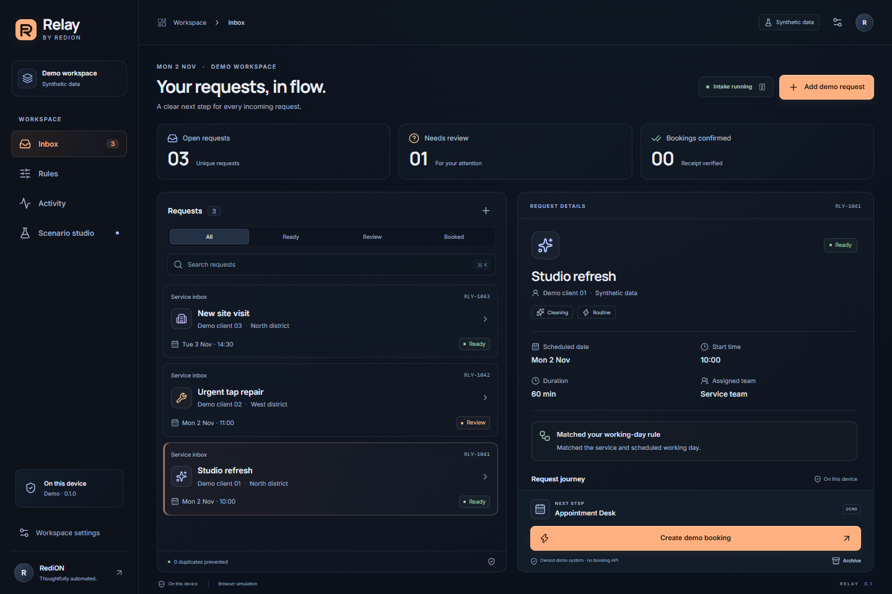
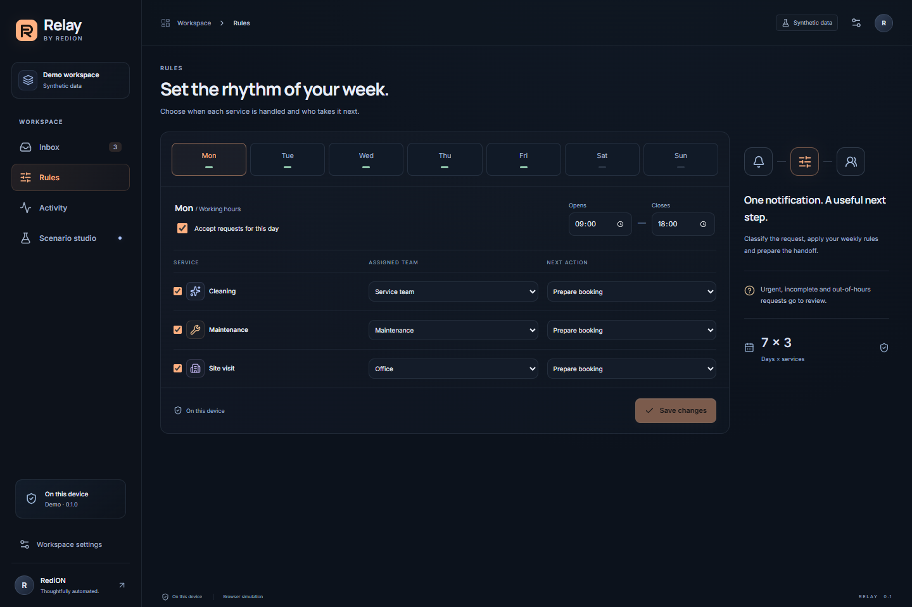
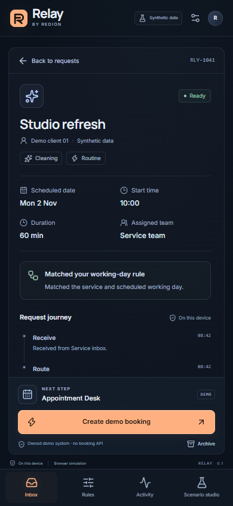
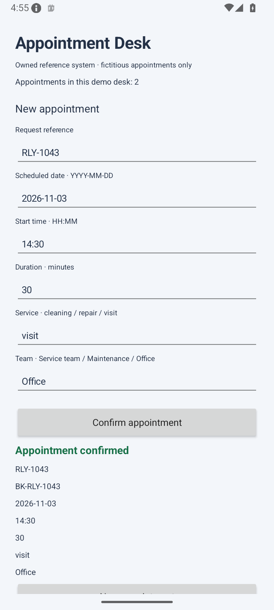

<h1 align="center">RediON Relay</h1>

<strong>Business requests, in flow.</strong> Local-first request routing, weekly rules and verified UI-assisted scheduling.

A compact workspace for small cleaning, maintenance and site-service teams.
Incoming requests receive a category, a scheduled day, an assigned team and a
clear next step. Uncertain requests remain visible for human review.

**MVP · 1 November 2026 · Synthetic demonstration**

## From notification to a checked outcome

1. **Receive.** Android processes notifications only from explicitly selected sources.
2. **Route.** Rules use the appointment's weekday, service, working hours and team.
3. **Review.** Urgent, incomplete or ambiguous requests stay with the operator.
4. **Prepare.** The operator requests a booking in the owned reference scheduler.
5. **Verify.** Relay fills the visible form, confirms once and checks the exact receipt.

The scheduling reference exposes no appointment-creation API. The adapter interacts
with the actual UI. A click by itself never counts as a confirmed booking.

## Watch the native workflow

[Watch the Android emulator recording · 15 seconds](docs/assets/native-workflow-en.mp4)

A fictitious request moves through our native reference form and returns with a
matching receipt. Captured from Android API35, not a physical-device/customer pilot.
[English captions](docs/assets/native-workflow-en.vtt).

## A working week, not one global rule

Each weekday owns its working window and independent service/team rules. Changing
Monday does not overwrite Tuesday. Routing follows the requested appointment date.

<strong>Phone interface and native confirmation</strong>

| Browser phone layout | Android emulator confirmation |
| --- | --- |
|  |  |

The browser is a labelled sandbox. Android runs Kotlin intake and persistence
independently of its bundled React interface.

## Evidence that runs

| Layer | Verified evidence |
| --- | --- |
| Policy and state | 64 TypeScript tests; 24 Kotlin tests, including 36 shared policy fixtures |
| Browser | 10 end-to-end workflows: real DOM form, matching receipt, slot conflict, duplicates, review, persistence and phone layout |
| Android | Signed APK installation, actual OS notification intake, native UI form completion and matching stored receipt |
| Failure handling | Overlapping native appointment rejected; no additional appointment stored |
| Background and consent | Unselected source ignored; selected owned test-source notification stored with MainActivity in background; pause blocks the next notification |
| Release | Dedicated RSA3072 signing identity, APK verification, release update preserving the demo's confirmed records |

All requests, clients, teams and appointments shown here are fictitious.
Compilation, browser simulation, Android emulation and physical-device use are
separate evidence levels. No physical-device acceptance or customer deployment is claimed.

## Designed around boundaries

- Local structured data; no Android Internet permission, cloud account or telemetry.
- Separate notification-source and optional Accessibility adapter consent.
- Native adapter limited to the signed, owned reference scheduling package.
- Durable attempt reservation; uncertain outcomes require review instead of blind replay.
- Android or a source app may limit notification content. Missing details stay in review.
- English/German UI, keyboard support, reduced motion and local fonts.

Source code and APK distribution remain private. This repository documents product
capabilities and actual synthetic evidence. Real customer integrations require the
system owner's authorization, platform/contract review and dedicated acceptance tests.
It does not imply legal certification, third-party endorsement or Play Store approval.

## Product rationale

Response speed matters to service businesses; [Jobber's home-service research](https://www.getjobber.com/home-service-trends-report/)
provides directional vendor evidence. [Microsoft documents UI automation for modern and legacy applications](https://learn.microsoft.com/en-us/power-automate/desktop-flows/introduction)
where suitable APIs are absent. Neither source establishes paying demand for Relay.
Customer discovery and a narrowly scoped pilot are the next commercial steps.

**Stack:** Kotlin · React · TypeScript · Motion · Lucide · Vitest · Playwright · JUnit.

[Architecture](docs/architecture.md) · [Evidence and limits](docs/evidence.md) ·
[Media lineage](docs/media-index.json) · [Redion Cekrezi](https://www.redioncekrezi.de/)
